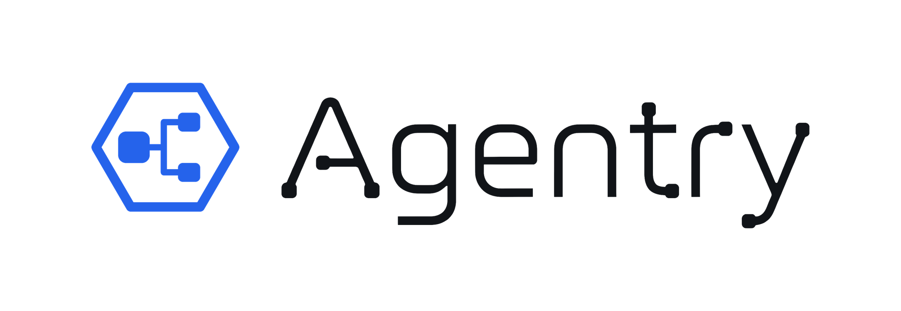

<p align="center">
  <picture>
    <source media="(prefers-color-scheme: dark)" srcset="design/logo/agentry-lockup-dark.png">
    
  </picture>
</p>

<p align="center"><b>把 AI agent 的工作流画出来，放进你的编程 agent 里运行，每一步都看得见。</b></p>

<p align="center"><a href="README.md">English</a> · 简体中文</p>

---

Agentry 由两部分配合工作：

- **编辑器**：在画布上摆放 agent，把一个 agent 的输出连到下一个 agent 的输入，再加上分支、条件、循环和并行步骤。结果是一份普通的 `workflow.yaml`，可以直接阅读、对比差异、提交到 git。
- **[opencode](https://opencode.ai) 运行插件**：负责执行这份文件。互不依赖的步骤同时运行；每一步的输出都存到磁盘上；每步之后都有检查点，中断了可以从断点接着跑；运行过程在实时面板里看得到。

> **状态：0.1 预览版。** 目前在 opencode 上运行。0.x 版本之间，YAML 格式还可能变化。

## 演示

六段在真实电脑上录制的短片。每一段都是触发器自动启动 workflow，右侧是实时面板。运行过程经过加速，角落的标记显示播放速度。

**每次 push 自动审代码。** push 到一个 PR 的分支后，workflow 读取改动，同时找 bug、查安全问题、跑测试，最后在 PR 上发一条审查意见。

https://github.com/user-attachments/assets/52aa8e28-d228-4792-b281-c18b6ff9b90b

**整理收件箱。** 新邮件一到就分流：急件起草回复，钓鱼邮件打上警告标签，推广邮件归档。标签和草稿在运行过程中就出现在 Gmail 里。

https://github.com/user-attachments/assets/a4604c60-8ff8-4757-abfd-11782e6b856b

**跟着改期改日历。** 邮件说期中考试改期了，workflow 找到日历里原有的那场考试并挪过去，而不是再新建一个。

https://github.com/user-attachments/assets/430a35ec-1fcc-467e-b6a3-5c9911fd20c9

**从课程网站同步截止日期。** 课程网站发布了新作业，它的截止日期随即出现在日历里。

https://github.com/user-attachments/assets/00f13dae-d09f-4f7c-af07-32cf228b4ecb

**整理下载的文件。** 下载下来名叫 `download.pdf` 的文件，被读取内容、按内容改名，再放进对应课程的文件夹。

https://github.com/user-attachments/assets/4a6308b7-eef5-43d2-8a85-7900bde0aacb

**写周报。** 每周五下午 5 点，同时汇总这一周的提交、日程和邮件，写出周报并修改一轮，最后作为草稿留在 Gmail 里，等人确认后发送。

https://github.com/user-attachments/assets/0ca33f9b-70fd-4dce-b958-42e703f32c6f

这些短片里用到的 Gmail 和 Google 日历小工具不在本仓库中。

## 功能

- **编辑器**：桌面应用（Tauri），也能在浏览器里用。连线以直角绕开节点，拖动节点时实时跟着走。每个节点都有属性面板；引用断了、必需字段没有任何步骤产出这类问题，编辑时就会提示。支持 YAML 导入导出、本地历史和 15 套配色。
- **控制流**：按节点输出里的某个字段，从几个下一步里选一个走；上游输出满足条件才执行某一步；一步重复执行，直到输出表示完成为止（有次数上限）；第一个上游完成就继续，或者等全部完成；一条连线上只传部分字段；把整个 workflow 当成一个节点嵌进来。
- **工具步骤**：不经过模型的步骤：发 HTTP 请求、读写项目里的文件、运行脚本。它们的输出是 JSON，后面的步骤和分支可以直接用里面的字段。
- **运行时**：opencode 插件并行执行互不依赖的步骤，把每一步的输出和日志写到 `.agentry/runs/` 下，能从最近的检查点续跑，在独立窗口里打开实时面板，最后还能生成一份 Markdown 报告，写清每一步做了什么。
- **在编辑器里看运行**：让编辑器指向你的项目，运行时就在你画图的那块画布上逐个点亮。
- **触发器**：`agentry-watch` 会在这些时候自动启动 workflow：文件夹里来了新文件、到了设定时间、网页或 Gmail 收件箱有变化、你 push 到了某个 git 分支。

## 快速开始

1. 安装 [opencode](https://opencode.ai)。已在 opencode 1.18.34 和 1.17.20 上测试。
2. 把插件放进你的项目，它只有一个文件：

   ```sh
   mkdir -p .opencode/plugins
   curl -fsSL -o .opencode/plugins/agentry.js https://raw.githubusercontent.com/Kenny-JT/agentry/main/.opencode/plugins/agentry.js
   ```

   在 Windows PowerShell 里，把 `curl` 换成 `curl.exe`。opencode 第一次打开这个项目时，会把插件唯一的依赖装进 `.opencode/`，大约需要一分钟。
3. 在项目的 `workflows/` 文件夹里放一个 workflow，比如本仓库的 [`workflows/code-review.yaml`](workflows/code-review.yaml)；也可以在编辑器里画好再导出。
4. 在项目里启动 opencode，让它「用 agentry 运行 `workflows/code-review.yaml`」。它会调用 `agentry_run` 工具，实时面板随之打开。

编辑器的安装包会随第一个正式版本一起发布，在那之前请从源码运行（见下文）。

## workflow 文件长什么样

```yaml
introduction: Review a change from two angles, then summarize
type: pipeline
input:  { description: "The diff to review" }
output: { description: "One review comment" }
agents:
  find_bugs:
    prompt: List real bugs in the diff. Ignore style.
    agent_mapping: { opencode: explore }
    output: { schema: { bugs: "string[]" } }
  check_security:
    prompt: List security problems in the diff.
    agent_mapping: { opencode: explore }
    output: { schema: { issues: "string[]" } }
  summarize:
    input: { from: [find_bugs, check_security] }
    prompt: Merge both lists into one short review comment.
    agent_mapping: { opencode: build }
    output: { schema: { comment: string } }
workflow: [find_bugs, check_security, summarize]
```

`find_bugs` 和 `check_security` 同时开始；两个都完成后，`summarize` 才开始。

| 字段 | 作用 |
|---|---|
| `agents` | 所有步骤，以 id 为键。每一步有 `prompt`、执行它的 opencode agent（`agent_mapping.opencode`），以及回答的结构（`output.schema`）。 |
| `input.from` | 这一步接收谁的输出。写多个 id 时等全部完成；加上 `input.join: any` 则第一个完成就继续。 |
| `input.select` | 只把上游输出里列出的字段传给这一步。 |
| `trigger.when` | 上游输出包含或等于某个值时才执行这一步，否则跳过。 |
| `trigger.loop` | 重复执行这一步，直到 `exit_when` 满足，最多 `max` 次。 |
| `type: branch`、`branch_on`、`routes` | 读取这一步输出里的一个字段，走第一条条件满足的路线。 |
| `type: tool`、`tool` | 不经过模型的步骤，见下面的[工具步骤](#工具步骤)。 |
| `on` | 让 workflow 自己启动：`file`、`schedule`、`web`、`mail` 或 `git`。 |
| `workflow` | 所有步骤的 id，也是显示顺序。没列进来的步骤不会运行。 |

完整说明见 [`packages/core/src/workflow.ts`](packages/core/src/workflow.ts) 里带注释的类型定义。

### 工具步骤

`type: tool` 的步骤不经过模型就能完成。把下面这一步加到上面的例子里，就能把审查意见存成文件：

```yaml
  save_review:
    type: tool
    input: { from: summarize }
    tool:
      kind: write_file
      path: reviews/latest.md
      content: "{summarize.comment}"
    output: { schema: { path: string, bytes: number, mode: string } }
```

| `kind` | 字段 | 输出 |
|---|---|---|
| `http` | `url`、`method`、`headers`、`body`、`timeout_s`、`allow_failure` | `status`、`ok`、`content_type`、`body` |
| `read_file` | `path` | `path`、`bytes`、`content`；文件是 JSON 时还有 `json` |
| `write_file` | `path`、`content`、`mode`（`overwrite` 或 `append`） | `path`、`bytes`、`mode` |
| `script` | `command`、`cwd`、`timeout_s`、`allow_failure` | `exit_code`、`stdout`、`stderr`；stdout 是 JSON 时还有 `result` |

- `{step_id}` 填入某个上游步骤的完整输出，`{step_id.field}` 填入其中一个字段，`{input}` 填入这次运行的输入。在 `url` 里，填入的值会做 URL 编码，除非整个 URL 就是一个引用。
- 文件路径和脚本的 `cwd` 必须在项目目录之内，指向外面的路径会让这一步失败。
- 写成列表的 `command` 不经过 shell 直接运行，每一项都可以包含引用；写成字符串的 `command` 在 shell 里运行，并且永远不会被上游输出填充——脚本改从 stdin 读取 JSON 格式的运行输入和上游输出。在 Windows 上，`npm`、`pnpm`、`npx` 需要用字符串形式。
- 脚本以你自己的用户权限运行，和你亲手启动的脚本一样。
- HTTP 状态码不是 2xx、或脚本退出码不为 0 时，这一步失败，除非设了 `allow_failure: true`。超时一定失败，默认 HTTP 30 秒、脚本 120 秒。`read_file` 最多读 2 MB；非 JSON 的 HTTP 响应体在 256 KB 处截断，脚本输出在 64 KB 处截断。

## 让 workflow 自动启动

在 workflow 里加一个 `on:` 块：

```yaml
on:
  git: { repo: ., branch: main }               # push 到 main 之后
  schedule: { at: "Fri 17:00" }                # 每周五下午 5 点
  file: { path: ~/Downloads, match: "*.pdf" }  # Downloads 里来了新的 PDF
```

然后让 `agentry-watch` 一直为这个项目运行着。它把触发事件（新文件、新提交、新邮件）交给 workflow 的第一批步骤，并在 `127.0.0.1:4096` 的 opencode 服务上运行 workflow；没有在运行的服务就自己启动一个：

```sh
pnpm --filter @agentry/trigger build
node packages/trigger/dist/agentry-watch.mjs --dir path/to/your/project
```

`mail` 触发器读取 Gmail，需要一个 Google OAuth 客户端：先运行一次 `agentry-watch auth google --client client.json`。

## 从源码运行

需要 Node 22.6 或更新版本和 pnpm 11。桌面窗口还需要 Rust 和 [Tauri 的系统依赖](https://v2.tauri.app/start/prerequisites/)。

```sh
pnpm install
pnpm dev          # 在浏览器里打开编辑器，http://localhost:5173
pnpm tauri dev    # 在桌面窗口里打开编辑器
pnpm verify       # CI 检查的全部内容
```

目录结构、PR 流程和发版方法见 [`CONTRIBUTING.md`](CONTRIBUTING.md)。

## 仓库结构

| 路径 | 内容 |
|---|---|
| `packages/core` | `workflow.yaml` 的类型、校验和运行语义，其它所有包都依赖它 |
| `packages/canvas` | 节点画布，编辑器和实时面板共用 |
| `packages/app` | 编辑器（Vite + React，用 Tauri 打包成桌面应用） |
| `packages/plugin` | opencode 插件，构建产物是 `.opencode/plugins/agentry.js` |
| `packages/trigger` | `agentry-watch` |
| `packages/design` | 设计 token 和配色主题 |
| `workflows/` | 示例 workflow |

## 关于 opencode 插件

- 插件从不往终端输出，否则会画到 opencode 的界面上。它的日志写在 opencode 自己的日志文件里（`opencode debug paths` 会显示所在文件夹），搜索 `[agentry]` 即可。
- 分支路由和字段过滤需要 JSON 格式的回答。插件在 prompt 里要求返回 JSON，不合格再追问一次；没有用 opencode 的 `format` 选项，因为它会强制调用工具，有些模型会直接拒绝。

## 许可证

[MIT](LICENSE)
